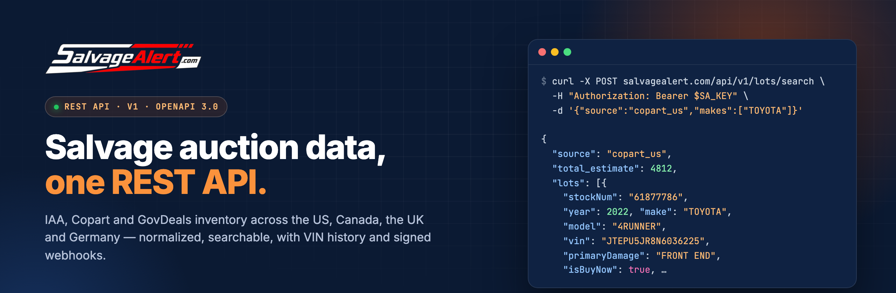
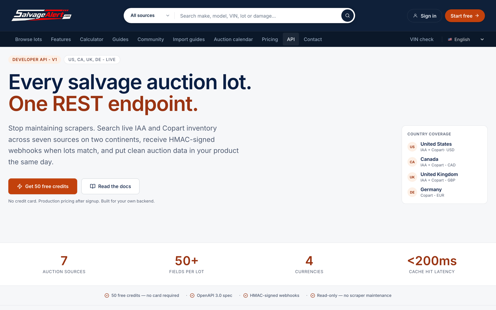
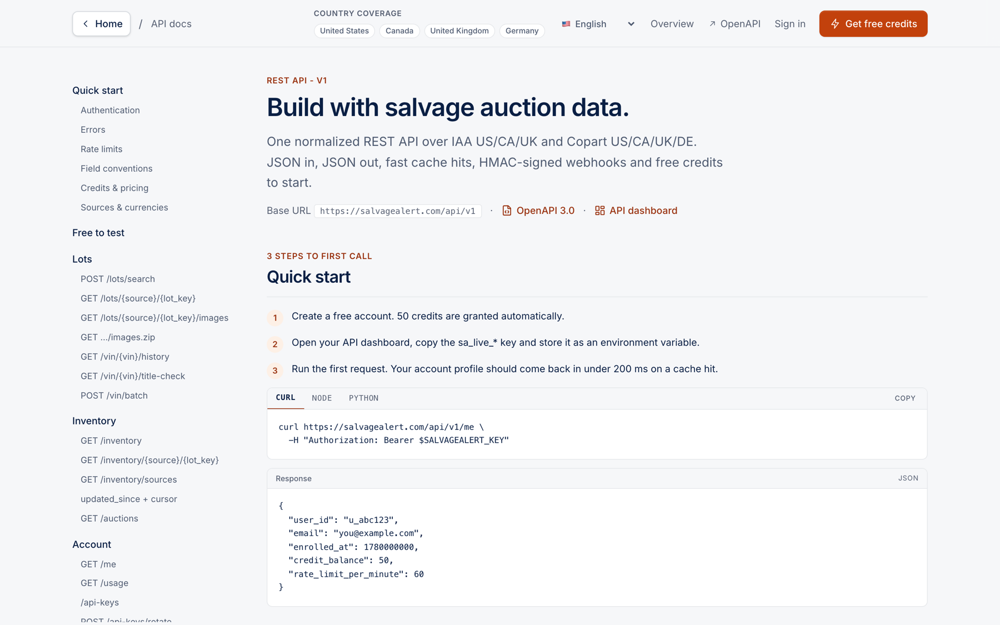
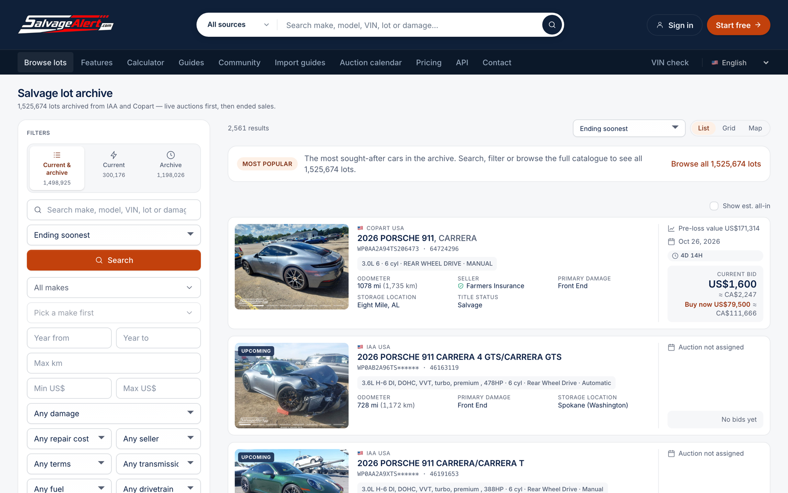
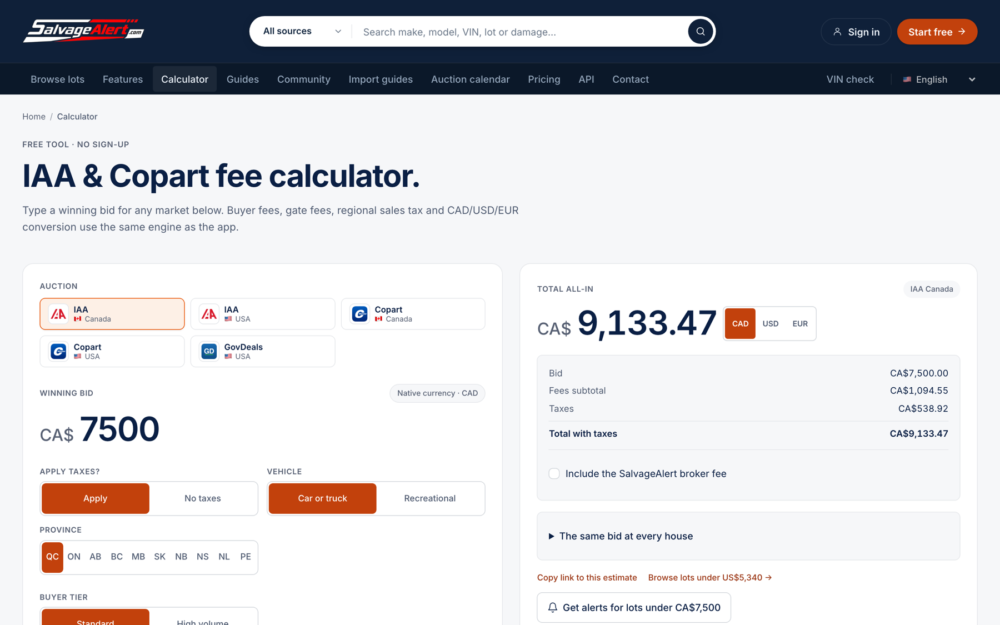
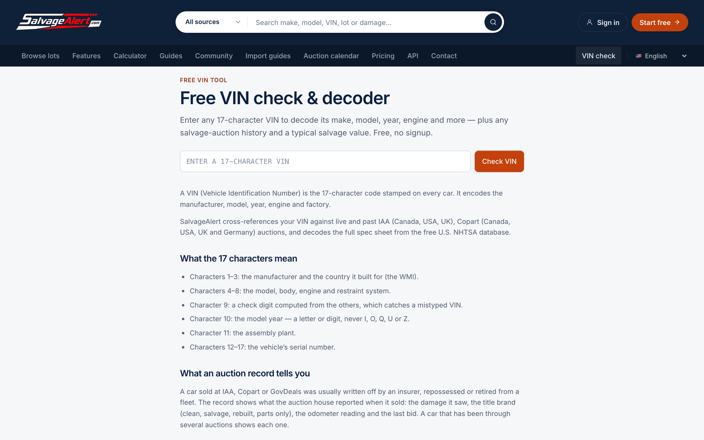
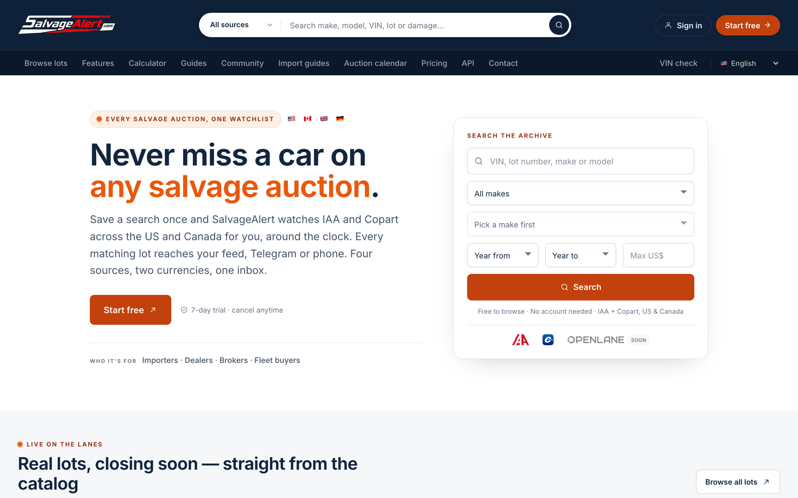

<div align="center">

<a href="https://salvagealert.com/developers">
  
</a>

<br><br>

**The official guide, examples and OpenAPI spec for the [SalvageAlert](https://salvagealert.com) Developer API.**

Search live IAA, Copart and GovDeals inventory across the US, Canada, the UK and Germany, look up VIN histories,
estimate buyer fees, and get signed webhooks when a lot matches your filters. No scrapers to maintain.

<br>

[](openapi/openapi.json)
[](https://salvagealert.com/api/v1/openapi.json)
[](https://salvagealert.com/register)
[](https://salvagealert.com)

<br>

[**Get an API key**](https://salvagealert.com/app/api) &nbsp;·&nbsp;
[**Reference docs**](https://salvagealert.com/developers/docs) &nbsp;·&nbsp;
[**Quick start**](#-quick-start) &nbsp;·&nbsp;
[**Examples**](examples) &nbsp;·&nbsp;
[**Postman**](postman) &nbsp;·&nbsp;
[**Changelog**](CHANGELOG.md)

</div>

<br>

## Contents

- [Why SalvageAlert](#-why-salvagealert)
- [Quick start](#-quick-start)
- [Coverage](#-coverage)
- [Endpoints at a glance](#-endpoints-at-a-glance)
- [Guides](#-guides)
- [Code examples](#-code-examples)
- [Credits, plans and rate limits](#-credits-plans-and-rate-limits)
- [Errors](#-errors)
- [Field conventions (read these first)](#%EF%B8%8F-field-conventions-read-these-first)
- [Webhooks](#-webhooks)
- [Screenshots](#-screenshots)
- [FAQ](#-faq)
- [Support](#-support)

<br>

## ✦ Why SalvageAlert

<table>
<tr>
<td width="33%" valign="top">

### One schema, eight sources
IAA US, Canada and UK, Copart US, Canada, UK and Germany, and GovDeals, all returned as one normalized `Lot` object. You write one parser.

</td>
<td width="33%" valign="top">

### Live and archived
`/lots/search` queries the auction houses live. `/inventory` pages through our de-duplicated archive of **1.5M+ lots**, with a keyset cursor and `updated_since` deltas for mirroring.

</td>
<td width="33%" valign="top">

### Push, don't poll
Save a filter set as a **watch** and we POST HMAC-signed `lot.matched`, `lot.updated` and `lot.sold` events to your endpoint, with retries over about 35 hours.

</td>
</tr>
<tr>
<td width="33%" valign="top">

### VIN intelligence
Relisting history across every source, title-brand checks, batch lookups of up to 50 VINs, NHTSA decode, recalls, crash ratings and fuel economy.

</td>
<td width="33%" valign="top">

### Fees and money
All-in buyer-fee estimates for IAA and Copart in CA, US, UK and DE, including provincial and state sales tax and VAT. Daily FX reference rates.

</td>
<td width="33%" valign="top">

### Honest metering
Cache hits cost **0 credits**. A VIN with no history is free. Every response tells you what it cost (`X-Credits-Charged`) and what you have left (`X-Credits-Balance`).

</td>
</tr>
</table>

<br>

## 🚀 Quick start

**1. Get a key.** [Create a free account](https://salvagealert.com/register). 50 credits are granted on signup, no card needed. Then copy your `sa_live_…` key from the [API dashboard](https://salvagealert.com/app/api).

```bash
export SALVAGEALERT_KEY="sa_live_xxxxxxxxxxxxxxxxxxxxxxxxxxxxxxxx"
```

**2. Check your account.** This call is free.

```bash
curl https://salvagealert.com/api/v1/me \
  -H "Authorization: Bearer $SALVAGEALERT_KEY"
```

```json
{
  "user_id": "u_abc123",
  "email": "you@example.com",
  "plan": "free",
  "credit_balance": 50,
  "rate_limit_per_minute": 60
}
```

**3. Search lots.** 1 credit, or 0 on a cache hit.

```bash
curl -X POST https://salvagealert.com/api/v1/lots/search \
  -H "Authorization: Bearer $SALVAGEALERT_KEY" \
  -H "Content-Type: application/json" \
  -d '{
        "source": "copart_us",
        "makes": ["TOYOTA"],
        "year_min": 2020,
        "title_types": ["salvage", "clean"],
        "page_size": 25
      }'
```

```json
{
  "source": "copart_us",
  "page": 1,
  "page_size": 25,
  "total_estimate": 4812,
  "filtered_out": 3,
  "cached": false,
  "lots": [
    {
      "stockNum": "61877786",
      "vin": "JTEPU5JR8N6036225",
      "year": 2022,
      "make": "TOYOTA",
      "model": "4RUNNER",
      "primaryDamage": "FRONT END",
      "odometerUnit": "mi",
      "isBuyNow": true,
      "buyNowPrice": "$9,950",
      "auctionDateUTC": 1787234400000,
      "isAuctionClosed": false,
      "imageUrl": "https://…",
      "detailUrl": "https://www.copart.com/lot/61877786"
    }
  ]
}
```

That's it. The full step-by-step walkthrough is in [`docs/getting-started.md`](docs/getting-started.md).

<br>

## 🌍 Coverage

| Source ID     | Marketplace                 | Country | Currency | `/lots/search` | Lot by stock # | `/inventory` | Photos API |
|---------------|-----------------------------|:-------:|:--------:|:-:|:-:|:-:|:-:|
| `copart_us`   | Copart USA                  | 🇺🇸 | USD | ✅ | ✅ | ✅ | ✅ |
| `copart_ca`   | Copart Canada               | 🇨🇦 | CAD | ✅ | ✅ | ✅ | ✅ |
| `copart_uk`   | Copart UK                   | 🇬🇧 | GBP | ✅ | ✅ | ✅ | ✅ |
| `copart_de`   | Copart Germany              | 🇩🇪 | EUR | ✅ | ✅ | ✅ | — |
| `iaai_us`     | IAA USA                     | 🇺🇸 | USD | ✅ | ✅ | ✅ | ✅ |
| `iaai_ca`     | IAA Canada                  | 🇨🇦 | CAD | ✅ | ✅ | ✅ | ✅ |
| `iaai_uk`     | IAA UK (SYNETIQ)            | 🇬🇧 | GBP | ✅ | via `/inventory/{source}/{lot_key}` | ✅ | — |
| `govdeals_us` | GovDeals (US gov. surplus)  | 🇺🇸 | USD | ✅ | via `/inventory/{source}/{lot_key}` | ✅ | — |

Every lot is priced in its source's own currency. Only `/stats/market` normalizes to USD. More in [`docs/sources.md`](docs/sources.md).

<br>

## 📚 Endpoints at a glance

Base URL: **`https://salvagealert.com/api/v1`**. Authentication: `Authorization: Bearer sa_live_…`.

<details open>
<summary><b>Lots and VINs</b></summary>

| Method | Path | What it does | Credits |
|---|---|---|:-:|
| `POST` | [`/lots/search`](docs/searching-lots.md) | Live search on one source | 1 (0 cached) |
| `GET` | `/lots/{source}/{lot_key}` | One live lot by stock number | 1 |
| `GET` | `/lots/{source}/{lot_key}/images` | Every gallery photo URL | 4 |
| `GET` | `/lots/{source}/{lot_key}/images.zip` | All photos as a ZIP | 8 |
| `GET` | [`/vin/{vin}/history`](docs/vin-data.md) | Every lot a VIN has appeared as | 1 (0 if unknown) |
| `GET` | `/vin/{vin}/title-check` | Title-brand / salvage-history check | 1 |
| `POST` | `/vin/batch` | History for up to 50 VINs | 1 per VIN found |

</details>

<details>
<summary><b>Archived inventory</b></summary>

| Method | Path | What it does | Credits |
|---|---|---|:-:|
| `GET` | [`/inventory`](docs/inventory-and-mirroring.md) | Browse / mirror the archive (page or cursor) | 1 |
| `GET` | `/inventory/{source}/{lot_key}` | One archived lot by identity | 1 (0 on miss) |
| `GET` | `/inventory/sources` | Per-source counts and freshness | 0 |
| `GET` | `/auctions` | The auction calendar | 0 |

</details>

<details>
<summary><b>Vehicle data, market, fees and currency</b></summary>

| Method | Path | What it does | Credits |
|---|---|---|:-:|
| `GET` | `/vehicles/vin/{vin}` | NHTSA VIN decode | 0.2 |
| `GET` | `/vehicles/safety` | Recalls and crash-test ratings | 0.2 |
| `GET` | `/vehicles/fuel-economy` | Fuel economy | 0.2 |
| `GET` | `/stats/market` | Price snapshot for a make / model | 1 |
| `GET` | [`/fees/estimate`](docs/fees-and-taxes.md) | All-in buyer fees for a hammer price | 0.2 |
| `GET` | `/fx` | Daily reference exchange rates | 0.2 |

</details>

<details>
<summary><b>Watches and webhooks</b></summary>

| Method | Path | What it does | Credits |
|---|---|---|:-:|
| `GET` `POST` | [`/watches`](docs/webhooks.md) | Saved filter sets that fire events | 0 |
| `PATCH` `DELETE` | `/watches/{id}` | Pause, resume, relabel, delete | 0 |
| `GET` `POST` | `/vin-watches` | Watch one vehicle by VIN | 0 |
| `GET` `PATCH` `DELETE` | `/vin-watches/{id}` | Read, edit, delete a VIN watch | 0 |
| `POST` | `/vin-watches/{id}/run` | Run a VIN watch now | 0 |
| `GET` `POST` | `/webhooks` | List / create webhook endpoints | 0 |
| `GET` `PATCH` `DELETE` | `/webhooks/{id}` | Manage one endpoint | 0 |
| `POST` | `/webhooks/{id}/test` | Send a test delivery | 0 |
| `GET` | `/webhooks/{id}/deliveries` | Delivery log | 0 |
| `POST` | `/webhooks/{id}/deliveries/{deliveryId}/redeliver` | Redeliver one past delivery | 0 |

</details>

<details>
<summary><b>Account, keys and reference data</b></summary>

| Method | Path | What it does | Credits |
|---|---|---|:-:|
| `GET` | `/me` | Profile, plan, balance, limits | 0 |
| `GET` | `/usage` | Usage statistics per day | 0 |
| `GET` `POST` | `/api-keys` | List / mint keys | 0 |
| `DELETE` | `/api-keys/{id}` | Revoke one key | 0 |
| `POST` | `/api-keys/rotate` | Revoke every key, issue a new one | 0 |
| `GET` | `/matches`, `/matches.csv` | Your match history (JSON / CSV) | 0 |
| `GET` `PATCH` | `/matches/{id}` | Favorite, dismiss, annotate a match | 0 |
| `GET` | `/makes`, `/models`, `/yards` | Catalogues for building filters | 0 |

</details>

The machine-readable contract is [`openapi/openapi.json`](openapi/openapi.json) (mirrored from [the live spec](https://salvagealert.com/api/v1/openapi.json)). Import it into Postman, Insomnia, Bruno, or a code generator.

<br>

## 📖 Guides

| Guide | You'll learn |
|---|---|
| [Getting started](docs/getting-started.md) | Key, first call, reading the response headers |
| [Authentication and keys](docs/authentication.md) | Bearer auth, minting, revoking, rotating |
| [Searching lots](docs/searching-lots.md) | Every `/lots/search` filter, paging, caching |
| [Inventory and mirroring](docs/inventory-and-mirroring.md) | Keyset cursor, `updated_since` deltas, keeping a local copy |
| [VIN data](docs/vin-data.md) | History, title checks, batch lookups, decode, recalls |
| [Webhooks](docs/webhooks.md) | Watches, events, signature verification, retries |
| [Fees and taxes](docs/fees-and-taxes.md) | All-in cost estimates per marketplace |
| [Field conventions](docs/conventions.md) | Timestamps, booleans, casing, money |
| [Errors](docs/errors.md) | Every error code and what to do about it |
| [Credits and rate limits](docs/credits-and-rate-limits.md) | Costs, headers, back-off |
| [Sources](docs/sources.md) | What each marketplace supports |

<br>

## 💻 Code examples

Runnable, dependency-free examples live in [`examples/`](examples):

| | cURL | Node.js (18+) | Python (3.9+) |
|---|:-:|:-:|:-:|
| Account check | [me.sh](examples/curl/me.sh) | [me.mjs](examples/node/me.mjs) | [me.py](examples/python/me.py) |
| Search lots | [search.sh](examples/curl/search.sh) | [search.mjs](examples/node/search.mjs) | [search.py](examples/python/search.py) |
| VIN history | [vin-history.sh](examples/curl/vin-history.sh) | [vin-history.mjs](examples/node/vin-history.mjs) | [vin_history.py](examples/python/vin_history.py) |
| Fee estimate | [fees.sh](examples/curl/fees.sh) | — | [fees.py](examples/python/fees.py) |
| Mirror the archive | — | [mirror-inventory.mjs](examples/node/mirror-inventory.mjs) | [mirror_inventory.py](examples/python/mirror_inventory.py) |
| Create a watch + webhook | [watch.sh](examples/curl/watch.sh) | — | — |
| Webhook receiver (verifies HMAC) | — | [webhook-server.mjs](examples/node/webhook-server.mjs) | [webhook_server.py](examples/python/webhook_server.py) |

<details>
<summary><b>Node.js: search in 15 lines</b></summary>

```js
const res = await fetch('https://salvagealert.com/api/v1/lots/search', {
  method: 'POST',
  headers: {
    Authorization: `Bearer ${process.env.SALVAGEALERT_KEY}`,
    'Content-Type': 'application/json',
  },
  body: JSON.stringify({ source: 'iaai_ca', makes: ['HONDA'], year_min: 2019 }),
});

if (!res.ok) throw new Error((await res.json()).error.code);
const { lots, total_estimate } = await res.json();
console.log(`${total_estimate} lots, charged ${res.headers.get('x-credits-charged')} credit(s)`);
for (const lot of lots) {
  console.log(lot.year, lot.make, lot.model, lot.primaryDamage, new Date(lot.auctionDateUTC));
}
```

</details>

<details>
<summary><b>Python: search in 15 lines</b></summary>

```python
import json, os, urllib.request
from datetime import datetime, timezone

req = urllib.request.Request(
    "https://salvagealert.com/api/v1/lots/search",
    data=json.dumps({"source": "copart_uk", "makes": ["BMW"], "year_min": 2020}).encode(),
    headers={"Authorization": f"Bearer {os.environ['SALVAGEALERT_KEY']}",
             "Content-Type": "application/json"},
)
with urllib.request.urlopen(req) as res:
    body = json.load(res)

for lot in body["lots"]:
    when = lot["auctionDateUTC"] and datetime.fromtimestamp(lot["auctionDateUTC"] / 1000, timezone.utc)
    print(lot["year"], lot["make"], lot["model"], lot.get("ukCategory"), when)
```

</details>

<br>

## 💳 Credits, plans and rate limits

Every `/v1` call debits credits from one balance. A subscription includes a monthly grant, and [one-off credit packs](https://salvagealert.com/app/api) (1k / 5k / 20k) top it up at any time.

| Plan | Price | API credits / month | Requests / minute |
|---|---|:-:|:-:|
| **Free** | $0 | 50 on signup | 60 |
| **Starter** | $19.99/mo · $199/yr | 500 | 120 |
| **Unlimited** | $39.99/mo · $399/yr | 5,000 | 300 |

Current prices are on the [pricing page](https://salvagealert.com/pricing). Each response carries:

| Header | Meaning |
|---|---|
| `X-Credits-Charged` | What this call cost |
| `X-Credits-Balance` | What you have left |
| `X-Credits-Warning` | Present (`low`) once you're under 10% of your grant |
| `X-RateLimit-Limit` / `-Remaining` / `-Reset` | Your per-minute window |
| `Retry-After` | On a `429`, seconds until a slot frees |
| `X-Request-Id` | Quote it when you contact support |

More detail: [`docs/credits-and-rate-limits.md`](docs/credits-and-rate-limits.md).

<br>

## 🧯 Errors

Every non-2xx response has the same envelope. **Switch on `error.code`, never on `message`.**

```json
{
  "error": { "code": "insufficient_credits", "message": "This call costs 1 credit; your balance is 0." },
  "request_id": "6f1c2a7e-3b0d-4d7e-9a51-2f7f0c1b9e44",
  "balance": 0,
  "credits_url": "https://salvagealert.com/app/api",
  "plan_url": "https://salvagealert.com/pricing"
}
```

| Status | Typical codes | Billed? |
|:-:|---|:-:|
| `400` | `invalid_source`, `invalid_location`, `invalid_title_type`, `too_many_vins`… | Never |
| `401` | `missing_credentials`, `invalid_credentials`, `account_inactive` | Never |
| `402` | `insufficient_credits` | Never |
| `403` | `api_disabled`, `plan_gate` | Never |
| `500` / `502` | `internal_error`, `upstream_unavailable` (retry with back-off) | Never |
| `404` | `not_found`, `lot_not_found`, `no_data` | Unknown VIN: never. Live lot miss: a reduced miss fee |
| `429` | `rate_limit` (honour `Retry-After`) | Never |

The full list is in [`docs/errors.md`](docs/errors.md).

<br>

## ⚠️ Field conventions (read these first)

Four rules that will save you a debugging session:

1. **Timestamps are seconds, except two fields.** Every `*_at` field is Unix **seconds**. `sale_date_utc` and `auctionDateUTC` are **milliseconds**. Divide those two by 1000; never guess by magnitude.
2. **Booleans aren't uniform on `InventoryLot`.** `make_offer`, `wholesale_only`, `former_rental` and `offsite` are JSON booleans. `has_keys`, `drives` and `starts` are integers (`0`/`1`/`null`). `null` means "the source didn't say", not `false`.
3. **Casing depends on the endpoint.** `/lots/search` and `/lots/{source}/{lot_key}` return the camelCase `Lot`. Everything else is snake_case.
4. **Money strings are for display.** `current_bid` and `buy_now` may contain symbols and separators. Sort and compare on the numeric `*_value` fields.

And one promise from us: nothing in v1 is removed or changes meaning. New fields arrive without notice, so **ignore keys you don't recognise**. Details: [`docs/conventions.md`](docs/conventions.md).

<br>

## 🔔 Webhooks

```
  your watch (filters)            SalvageAlert                     your server
 ┌────────────────────┐   new lot   ┌────────────┐  POST + HMAC   ┌──────────────┐
 │ copart_us · TOYOTA │ ──────────▶ │  matcher   │ ─────────────▶ │ /hooks/sa    │
 │ 2020+ · salvage    │             │  + queue   │ ◀── 2xx ────── │ verify, 200  │
 └────────────────────┘             └────────────┘  retry ≤ 7x    └──────────────┘
```

Generic deliveries are signed Stripe-style:

```
X-Salvagealert-Signature: t=1761062400,v1=5f2b9c…
```

The signature is `HMAC-SHA256(secret, "<t>.<raw body>")`, hex-encoded. Verify it against the **raw** request body, compare in constant time, and reject old timestamps:

```js
import { createHmac, timingSafeEqual } from 'node:crypto';

function verify(rawBody, header, secret, toleranceSec = 300) {
  const parts = Object.fromEntries(header.split(',').map((p) => p.split('=')));
  const t = Number(parts.t);
  if (!t || Math.abs(Date.now() / 1000 - t) > toleranceSec) return false;
  const expected = createHmac('sha256', secret).update(`${t}.${rawBody}`).digest('hex');
  const a = Buffer.from(expected), b = Buffer.from(parts.v1 ?? '');
  return a.length === b.length && timingSafeEqual(a, b);
}
```

Discord and Slack URLs are auto-detected and get native message formatting, **but they aren't signed**. Pass `"format": "generic"` to keep the HMAC. Full guide with retry schedule and event shapes: [`docs/webhooks.md`](docs/webhooks.md).

<br>

## 🖼 Screenshots

<table>
<tr>
<td width="50%"><a href="https://salvagealert.com/developers"></a><p align="center"><sub><b>Developer portal</b>: <a href="https://salvagealert.com/developers">salvagealert.com/developers</a></sub></p></td>
<td width="50%"><a href="https://salvagealert.com/developers/docs"></a><p align="center"><sub><b>API reference</b> with cURL, Node and Python tabs</sub></p></td>
</tr>
<tr>
<td width="50%"><a href="https://salvagealert.com/lots"></a><p align="center"><sub><b>The catalogue</b> behind <code>/inventory</code>: <a href="https://salvagealert.com/lots">1.5M+ lots</a></sub></p></td>
<td width="50%"><a href="https://salvagealert.com/calculator"></a><p align="center"><sub><b>Fee engine</b> behind <code>/fees/estimate</code>: <a href="https://salvagealert.com/calculator">try it</a></sub></p></td>
</tr>
<tr>
<td width="50%"><a href="https://salvagealert.com/vin-check"></a><p align="center"><sub><b>VIN check</b> behind <code>/vin/{vin}/history</code>: <a href="https://salvagealert.com/vin-check">free VIN check</a></sub></p></td>
<td width="50%"><a href="https://salvagealert.com"></a><p align="center"><sub><b>SalvageAlert</b>: <a href="https://salvagealert.com">salvage auction alerts</a> for IAA and Copart</sub></p></td>
</tr>
</table>

<br>

## ❓ FAQ

<details>
<summary><b>Is this an official IAA or Copart API?</b></summary>
<br>
No. SalvageAlert is an independent service and isn't affiliated with IAA, Copart or GovDeals. We collect, normalize and archive public auction listings and serve them through one consistent API.
</details>

<details>
<summary><b>How fresh is the data?</b></summary>
<br>
<code>/lots/search</code> queries the source live, with a short shared cache. Cached pages are free and flagged with <code>"cached": true</code>. <code>/inventory</code> reads our continuously crawled archive, and <code>/inventory/sources</code> reports <code>newest_change_at</code> and a <code>stale</code> flag for each source.
</details>

<details>
<summary><b>Do lots come with full VINs?</b></summary>
<br>
Copart lots carry full, unmasked VINs across all four countries. IAA masks part of the VIN on public listings, so IAA lots have a full VIN only where an authenticated crawl reached them.
</details>

<details>
<summary><b>Can I mirror the whole catalogue?</b></summary>
<br>
Yes. That's what the <code>cursor</code> and <code>updated_since</code> modes of <code>/inventory</code> are for. Walk it once with the cursor, then pull deltas. See <a href="docs/inventory-and-mirroring.md">the mirroring guide</a> and <a href="examples/node/mirror-inventory.mjs">the example</a>.
</details>

<details>
<summary><b>Are hammer (sold) prices available?</b></summary>
<br>
Most salvage lots sell on approval and the auctions don't publish the final price. We report the best price we hold: the Buy Now price, or else the highest pre-bid. <code>/stats/market</code> aggregates those and says so.
</details>

<details>
<summary><b>Is there an SDK?</b></summary>
<br>
The API is small enough that <code>fetch</code> or <code>requests</code> is all you need, as the examples show. If you want typed clients, generate them from <a href="openapi/openapi.json">the OpenAPI spec</a>, for example with <code>npx @openapitools/openapi-generator-cli generate -i openapi/openapi.json -g typescript-fetch -o sdk</code>.
</details>

<br>

## 🤝 Support

- **Reference docs:** [salvagealert.com/developers/docs](https://salvagealert.com/developers/docs)
- **Dashboard (keys, usage, webhooks):** [salvagealert.com/app/api](https://salvagealert.com/app/api)
- **Contact:** [salvagealert.com/contact](https://salvagealert.com/contact) or support@salvagealert.com. Include the `request_id`.
- **Bugs in these docs or examples:** [open an issue](../../issues).
- **Security:** see [SECURITY.md](SECURITY.md).

<br>

---

<div align="center">
<a href="https://salvagealert.com"></a>
<br><br>
<sub>
<a href="https://salvagealert.com">Home</a> ·
<a href="https://salvagealert.com/lots">Browse salvage lots</a> ·
<a href="https://salvagealert.com/vin-check">VIN check</a> ·
<a href="https://salvagealert.com/calculator">Fee calculator</a> ·
<a href="https://salvagealert.com/copart-vs-iaa">Copart vs IAA</a> ·
<a href="https://salvagealert.com/pricing">Pricing</a> ·
<a href="https://salvagealert.com/developers">Developers</a>
</sub>
<br><br>
<sub>Examples and docs in this repository are MIT-licensed. The SalvageAlert API itself is governed by the <a href="https://salvagealert.com/legal/terms">Terms of Service</a>.<br>
SalvageAlert is independent and not affiliated with IAA, Copart or GovDeals. All trademarks belong to their owners.</sub>
</div>
